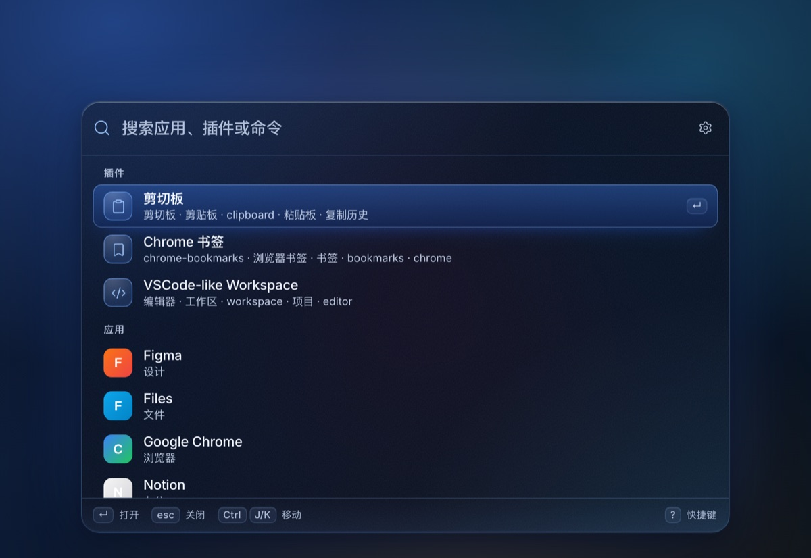
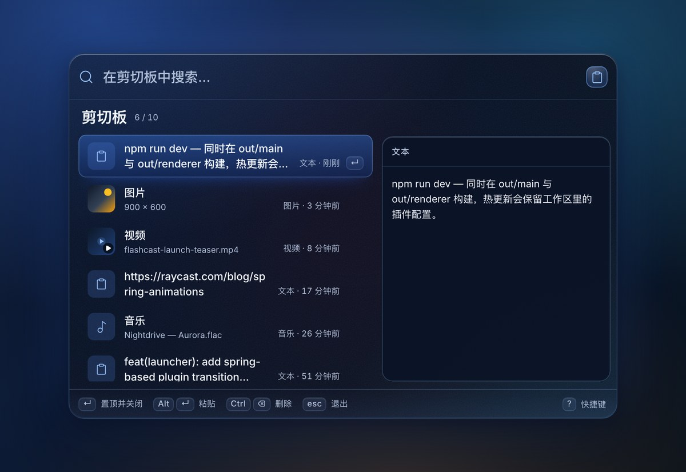
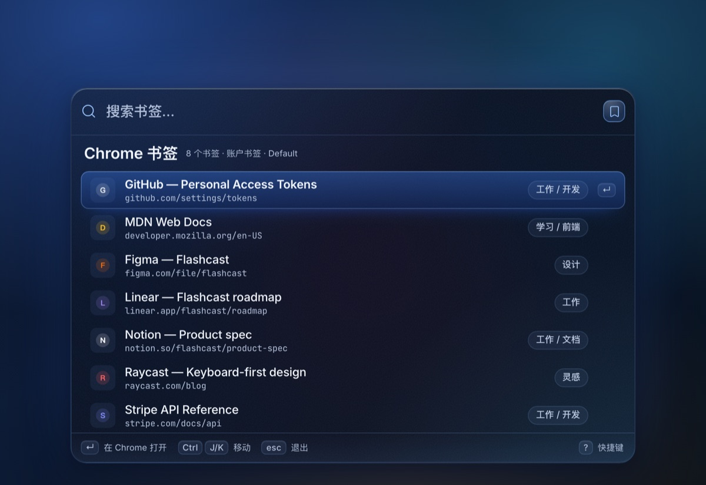
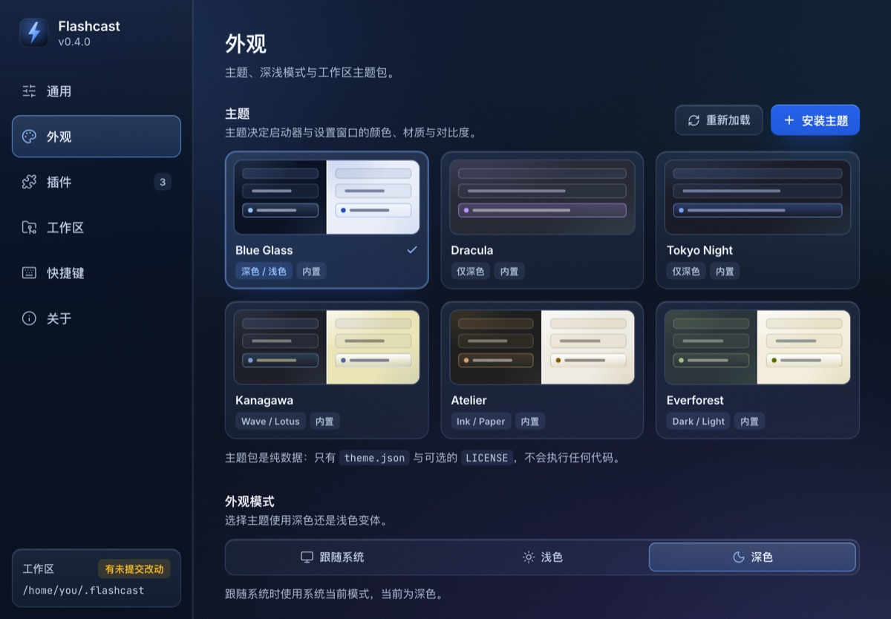

# Flashcast

像一道闪电一样打开工作流。Flashcast 是一个键盘优先、插件驱动、动画流畅的跨平台启动器，设计目标对齐 Raycast：输入即搜、`ctrl + j/k/h/l` 移动光标、流体式的窗口与插件切换、以及可版本化的工作区配置。



<table>
  <tr>
    <td></td>
    <td></td>
  </tr>
  <tr>
    <td align="center">剪切板插件 · 默认右侧预览</td>
    <td align="center">Chrome 书签插件 · 模糊匹配</td>
  </tr>
</table>



> 截图来自本仓库的真实 Electron 构建；示例工作区中包含 `examples/hello-flashcast` 外部插件。

## 功能

- **跨平台**：Linux / macOS / Windows；Electron + React + TypeScript。
- **全局快捷键**：`Alt/Option + Space` 开关启动器，`Ctrl+Alt+C` / `Ctrl+⌘+C` 直接进入剪切板。
- **Vim 风格导航**：应用内与插件内统一使用 `Ctrl + J/K/H/L`；方向键作为无障碍等价操作。
- **全局模糊搜索**：应用、插件关键字、命令统一搜索；子序列命中（`fbb` → `Foo-Bar-Baz`）、连续/词首加分、中文整串包含、逐字高亮。
- **插件机制**：类似 Cordis 的上下文/生命周期模型；从 Git 仓库或本地目录安装、启停、更新、卸载；插件设置由插件维护并存入工作区。
- **工作区**：关联一个 Git 仓库，集中保存配置、插件设置；自动提交并推送（可选）；状态、分支、最近提交、冲突与差异可视化。
- **流体动画**：启动器先出现输入框、再像液体一样长出列表，不做全屏压暗遮罩；插件进入/退出、预览水珠展开、列表 FLIP 删除、窗口收回后粘贴；遵循 `prefers-reduced-motion`。
- **内置插件**：
  - `剪切板`：文本 / 图片 / 视频 / 音乐；右侧默认预览、切换选中原位更新；回车置顶并关闭；`Alt/Option+Enter` 粘贴；`Ctrl+Backspace` 删除；二次确认清空。
  - `Chrome 书签`：自动发现 Chrome Profile、读书架、favicon、文件夹 chip、在 Chrome 中打开。
- **设置窗口**：通用（主题、开机自启、语言）、插件管理、工作区、快捷键录制、关于与许可。
- **无障碍**：完整键盘路径、可见焦点环、`aria-live` 结果播报、对比度按 UI 规范核算、减少动效/高对比适配。

## 技术栈

| 层 | 选择 |
|---|---|
| 桌面运行时 | Electron 45（原生全局快捷键、剪贴板、透明窗口、托盘） |
| UI | React 19 + TypeScript 5.9，手写设计令牌与动效 |
| 构建 | Vite 8 + electron-vite 6 |
| 图标 | Lucide（线性 1.5px） |
| 字体 | Inter Variable + JetBrains Mono（打包进应用，中文回退 Noto Sans CJK） |
| 测试 | Vitest |

UI/UX 规范要求跨平台毛玻璃、原生剪贴板与全局快捷键。Electron 是目前唯一能在三端同时覆盖这些能力的 Web 技术栈，因此项目按 Electron 实现；在 Linux 上按规范降级为不透明面板。

## 快速开始

前置：Node.js ≥ 22.12（Electron 45 要求），pnpm（版本由 `packageManager` 锁定为 pnpm 12；未安装时可用 `corepack enable`）。

```bash
pnpm install
pnpm dev           # 开发模式（electron-vite，已带 --noSandbox）
pnpm build         # 构建 main / preload / renderer 到 out/
pnpm start         # 预览构建产物
```

`pnpm dev` 会为 Electron 传入 `--noSandbox`，方便在未配置 Chrome SUID sandbox 的开发机（例如容器）里直接启动；**打包产物仍使用系统正常的 sandbox 配置**，不要默认关闭沙箱。`pnpm start` 预览构建产物时仍保留沙箱，若本机同样未配置 SUID sandbox，可改用 `pnpm start -- --noSandbox`。

`postinstall` 会下载 Electron 运行时；如果 GitHub 下载受限，可在安装前设置镜像，例如 `ELECTRON_MIRROR=https://npmmirror.com/mirrors/electron/ pnpm install`。

仅查看 UI（无需 Electron）的可视化预览：

```bash
pnpm preview:ui
# http://localhost:5199/?window=launcher
# http://localhost:5199/?window=launcher&preview=clipboard
# http://localhost:5199/?window=launcher&preview=bookmarks
# http://localhost:5199/?window=settings&page=plugins
# 支持 &theme=light、&platform=darwin 等预览参数
```

预览使用同一套 React 渲染器与 mock bridge，便于做视觉回归。

### 测试与类型检查

```bash
pnpm test
pnpm typecheck
```

### 打包

```bash
pnpm dist:linux
pnpm dist:mac
pnpm dist:win
```

`electron-builder.yml` 已配置三端目标（AppImage/deb、dmg/zip、nsis）、图标、`LSUIElement`（macOS 菜单栏应用）与 Linux 桌面项。修改 `build/*.svg` 后可运行 `pnpm icons` 重新生成 PNG 图标与视频封面占位图（需要本机有 Chrome/Chromium）。

## 快捷键

| 动作 | Linux | macOS | Windows |
|---|---|---|---|
| 开关启动器 | `Alt + Space` | `Option + Space` | `Alt + Space` |
| 直接打开剪切板 | `Ctrl + Alt + C` | `Control + Command + C` | `Ctrl + Alt + C` |
| 下 / 上 / 右 / 左 | `Ctrl + J/K/L/H` | `Control + J/K/L/H` | `Ctrl + J/K/L/H` |
| 打开选中项 | `Enter` | `Enter` | `Enter` |
| 剪切板置顶并关闭 | `Enter` | `Enter` | `Enter` |
| 剪切板置顶、关闭并粘贴 | `Alt + Enter` | `Option + Enter` | `Alt + Enter` |
| 删除剪切板项 | `Ctrl + Backspace` | `Control + Backspace` | `Ctrl + Backspace` |
| 清空剪切板（二次确认） | `Super + Alt + Backspace` | `Option + Command + Backspace` | `Win + Alt + Backspace` |
| 关闭 / 返回上一层 | `Esc` | `Esc` | `Esc` |
| 快捷键帮助 | `?` | `?` | `?` |

全局快捷键可在 **设置 → 快捷键** 中录制与恢复默认；冲突会即时提示。macOS 的“自动粘贴”需要辅助功能权限；Linux 的自动粘贴需要系统存在 `wtype`（Wayland）或 `xdotool`（X11），否则内容仍会复制到剪贴板并给出系统通知。

> **Linux Wayland 下的全局快捷键**：Electron 通过 `xdg-desktop-portal` 的 `GlobalShortcuts` 接口绑定快捷键，应用身份取自 `package.json` 的 `desktopName`（`com.flashcast.app.desktop`）。该身份必须能解析到已安装的同名 `.desktop` 文件，否则 xdg-desktop-portal 1.21+ / GNOME 50 会静默拒绝绑定（`globalShortcut.register()` 仍返回 `true`）。`pnpm dev` 会自动写入 `~/.local/share/applications/com.flashcast.app.desktop`（删除该文件即可移除，它会覆盖同名的打包安装项）；首次绑定会弹出一次系统确认框，允许后快捷键才真正生效。

## 工作区

首次启动会在 `~/.flashcast` 初始化一个带 `main` 分支的 Git 仓库，并提交初始配置。也可以在 **设置 → 工作区 → 重新关联仓库** 选择任意 Git 仓库。工作区布局：

```text
<workspace>/
├── config.json                  # 主题、快捷键、自动提交、插件启停
├── plugins/
│   ├── clipboard/config.json    # 每个插件的设置（纳入 Git）
│   └── chrome-bookmarks/config.json
├── extensions/                  # 外部插件代码（不纳入 Git）
├── state/                       # 剪切板历史/媒体、favicon 缓存（不纳入 Git）
├── README.md
└── .gitignore
```

- 自动提交默认关闭；开启后只提交 Flashcast 管理的路径（`config.json`、`plugins/`、`README.md`、`.gitignore`），不会 stage 仓库中的其他文件。
- 有 upstream 时自动尝试推送；没有远程仓库或推送失败会以状态/错误呈现，不阻塞配置保存。
- 开发与自动化可使用环境变量：
  - `FLASHCAST_WORKSPACE`：覆盖工作区路径
  - `FLASHCAST_USER_DATA`：覆盖 Electron userData（便于沙箱测试）
  - `FLASHCAST_CHROME_USER_DATA`：覆盖 Chrome 用户数据目录
  - `FLASHCAST_SHOW_ON_START=1`：开发时启动后立即展示启动器

## 插件系统

内置插件与外部插件共享同一份 manifest、关键字匹配、启用状态与工作区配置机制。外部插件的页面由宿主渲染，插件通过 manifest 中的设置 schema 与运行时 API 描述内容。

### 外部插件格式

```jsonc
// plugin.json
{
  "id": "hello-flashcast",
  "name": "Hello Flashcast",
  "version": "1.0.0",
  "description": "示例插件",
  "entry": "index.js",
  "icon": "icon.svg",
  "keywords": ["hello", "示例"],
  "searchable": true,
  "primaryAction": "复制问候",
  "configDefaults": { "greeting": "你好", "count": 5 },
  "settings": [
    { "key": "greeting", "label": "问候语", "type": "text" },
    { "key": "count", "label": "条目数量", "type": "number", "min": 1, "max": 10, "step": 1 }
  ]
}
```

```js
// index.js（CJS / ESM 均可）
module.exports = {
  async search(ctx, query) {
    const config = await ctx.config.get()
    return [{ id: '1', title: `${config.greeting} #1`, subtitle: '来自外部插件的示例条目' }]
  },
  async activate(ctx, item) {
    await ctx.services.copyText(item.title)
    return { ok: true, close: true, toast: { message: '已复制', tone: 'success' } }
  }
}
```

上下文能力：

| API | 说明 |
|---|---|
| `ctx.config.get()/set(patch)` | 读写当前插件在工作区中的配置 |
| `ctx.effect(fn)` / `ctx.onDispose(fn)` | 生命周期清理，禁用/卸载/重载时执行 |
| `ctx.plugin(nested)` | 组合子插件（Cordis 风格的 `apply`） |
| `ctx.services.openExternal(url)` | 仅允许 http/https/mailto |
| `ctx.services.copyText(text)` / `readClipboardText()` | 剪贴板能力 |
| `ctx.services.toast(message, tone)` | 宿主 Toast |
| `ctx.logger.*` | 带插件 id 前缀的日志 |

安装入口是 **设置 → 插件 → 安装插件**，支持 Git URL 或本地目录；安装前展示插件 id、版本、权限、文件大小与信任警告。完整的可运行示例位于 [examples/hello-flashcast](examples/hello-flashcast)。

> **安全边界**：外部插件在 Electron 主进程中以当前用户权限执行，不是沙箱。请仅安装可信来源；manifest 中的 permissions 仅用于展示，不构成操作系统级隔离。内置插件不可卸载。

## 架构

```text
┌──────────────── renderer (React) ────────────────┐
│ Launcher（搜索 / 键盘 / 动画）                    │
│ Settings（通用 / 插件 / 工作区 / 快捷键 / 关于）   │
│ 设计令牌 · Keycap · Preview · FLIP / 虚拟列表      │
└───────────────────────▲──────────────────────────┘
                        │ preload contextBridge（白名单）
┌───────────────────────┴──────────────────────────┐
│ main（Electron）                                  │
│ WindowManager · ShortcutManager · IPC             │
│ WorkspaceService · GitService · ConfigStore       │
│ PluginService · ExternalPluginManager             │
│ ClipboardService · ChromeBookmarks · FaviconCache │
│ AppDiscovery · NativePaste · CustomMediaProtocol  │
└──────────────────────────────────────────────────┘
```

更详细的模块说明、数据流、动效映射与需求对照见 [docs/implementation.md](docs/implementation.md)。

## 隐私与网络

- 剪切板历史、图片、插件设置、工作区状态全部保存在本地工作区；没有遥测。
- Chrome 书签插件的 favicon 会向 `https://www.google.com/s2/favicons` 请求，结果缓存在 `state/favicons`；离线或企业网络阻断时自动使用本地 `globe` 图标。
- 插件安装/更新会访问你输入的 Git 地址；应用自身不访问其他网络。

## 平台说明与已知限制

- **Linux 透明/模糊**：GNOME/KWin 等合成器下保留透明背景与 CSS 毛玻璃；按规范在没有窗口模糊支持时使用不透明 `#18181B` 面板。
- **Wayland 全局快捷键**：走 `xdg-desktop-portal` 的 `GlobalShortcuts`（Electron 45 默认启用，无需 feature flag）。应用身份来自 `package.json#desktopName`，必须与已安装的 `.desktop` 文件同名：开发时由 `pnpm dev` 写入 `~/.local/share/applications/com.flashcast.app.desktop`，打包时由 electron-builder 的 `syncDesktopName` 安装为同名文件。身份无法解析时系统会静默拒绝绑定，应用会在启动时写入设置页诊断并发系统通知；首次绑定需要用户在系统弹窗中确认。X11 会话直接抓键，不受影响。
- **自动粘贴**：macOS 使用 AppleScript（需辅助功能权限）；Windows 使用 PowerShell SendKeys；Linux 依赖 `wtype`/`xdotool`/`ydotool`。失败时保留系统剪贴板内容并发送系统通知。
- **剪切板文件类型**：图片会保存为本地媒体；视频/音乐读取文件 URI，恢复时写入 `text/uri-list` + 文本路径，部分文件管理器可能需要再复制一次才能得到原生文件对象。
- **视频封面**：若系统安装 `ffmpeg`，截取首帧作为封面；否则使用内置设计封面。视频不播放。
- **应用发现**：Linux 读取 `.desktop`；macOS 扫描 `/Applications` 等；Windows 扫描开始菜单快捷方式。部分 UWP/特殊打包应用可能不出现。
- **更新检查**：当前版本未配置发布源，“检查更新”会明确提示开发构建/未配置更新源。
- **结果分组**：所有分组结果均可滚动访问，不做隐藏式分页，以保证键盘可达性。
- **开发预览**：`pnpm preview:ui` 使用 mock bridge；它不会访问真实剪贴板/Chrome/Git。

## 目录

```text
src/main/        Electron 主进程、服务、插件宿主
src/preload/     contextBridge 白名单 API
src/renderer/    React 启动器与设置窗口、设计令牌
src/shared/      类型、模糊匹配、快捷键、时间格式化
examples/        外部插件示例
docs/            PRD、UI/UX 规格、实现说明、截图
scripts/         图标/封面生成、开发用桌面项（Wayland 全局快捷键身份）
```

## 许可

[MIT](LICENSE)。内置的 Inter / JetBrains Mono 字体、Lucide 图标与 Electron/React 等依赖遵循各自许可证。
