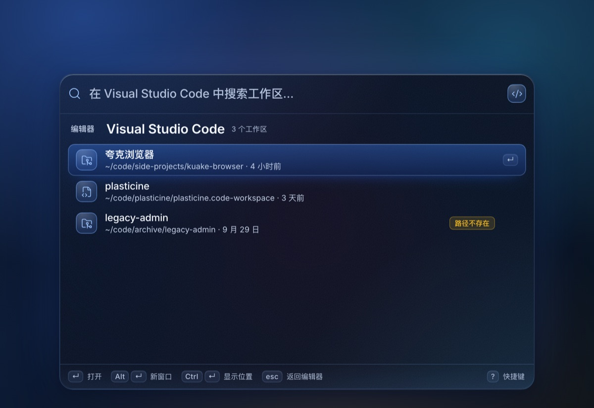
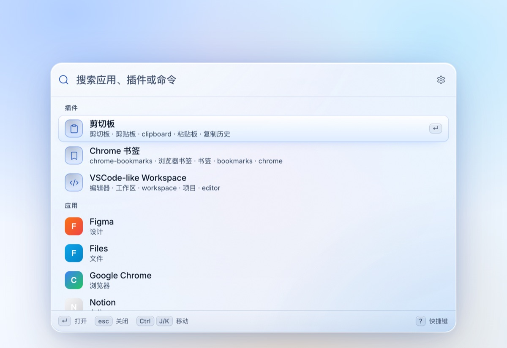

# Flashcast

[](https://github.com/Plasticine-Yang/flashcast/actions/workflows/ci.yml)
[](https://github.com/Plasticine-Yang/flashcast/releases)

像一道闪电一样打开工作流。Flashcast 是一个键盘优先、插件驱动、主题可换、动画流畅的跨平台启动器，设计目标对齐 Raycast：输入即搜、`Ctrl + J/K` 在列表内移动选中、`Ctrl + H/L` 在设置页切换焦点、流体式的窗口与插件切换、可版本化的工作区，以及可安装的工作区主题包。


<table>
  <tr>
    <td></td>
    <td></td>
  </tr>
  <tr>
    <td align="center">剪切板 · 常驻右侧预览</td>
    <td align="center">Chrome 书签 · 模糊匹配与文件夹</td>
  </tr>
</table>

<table>
  <tr>
    <td></td>
    <td></td>
  </tr>
  <tr>
    <td align="center">VSCode-like Workspace · 编辑器内工作区</td>
    <td align="center">设置 · 外观与内置主题</td>
  </tr>
</table>

> 截图由 `pnpm preview:ui` 生成：它与打包产物共用同一套 React 渲染器，通过 mock bridge 注入演示数据，不读取真实剪切板、Chrome 或 Git；`pnpm dev` 下的界面与此一致，数据来自本机。

## 功能

- **跨平台**：Linux / macOS / Windows；Electron + React + TypeScript。
- **全局快捷键**：`Alt/Option + Space` 开关启动器，`Ctrl+Alt+C` / `Control+⌘+C` 直接进入剪切板；可在设置中录制与恢复默认。
- **Vim 风格导航**：列表内用 `Ctrl + J/K` 移动选中；插件设置页用 `Ctrl + J/K` 在字段间移动，`Ctrl + H` 回到搜索框，`Ctrl + L` 跳到下一个字段；方向键作为无障碍等价操作。
- **全局模糊搜索**：应用、插件关键字、命令统一搜索；子序列命中（`fbb` → `Foo-Bar-Baz`）、连续/词首加分、中文整串包含、逐字高亮；书签与剪切板在各自页面内过滤。
- **拼音搜索**：中文条目支持全拼、混拼与首字母（`kualiulan`、`kualanqi`、`kllq` 都能命中「夸克浏览器」），多音字按上下文处理（`重庆` → `chongqing`），命中会标在对应汉字上；字面匹配仍然优先。
- **插件机制**：类似 Cordis 的上下文/生命周期模型；从 Git 仓库或本地目录安装、启停、更新、卸载；插件设置由插件维护并存入工作区。
- **主题与主题包**：内置 Blue Glass、Dracula、Tokyo Night、Kanagawa、Atelier、Everforest 六套主题，提供深色 / 浅色变体（Dracula、Tokyo Night 仅深色）；外部主题包放在工作区 `themes/`，可从 Git 仓库或本地目录安装；切换工作区即切换主题，并随工作区提交、推送。
- **工作区**：关联一个 Git 仓库，集中保存配置、插件设置、主题包与外部插件代码；自动提交并推送（可选）；状态、分支、最近提交、冲突与差异可视化。
- **流体动画**：启动器先出现输入框、再像液体一样长出列表，不做全屏压暗遮罩；插件进入/退出、预览水珠展开、列表 FLIP 删除、窗口收回后粘贴；遵循 `prefers-reduced-motion`。
- **内置插件**：
  - `剪切板`：文本 / 图片 / 视频 / 音乐；右侧预览常驻、切换选中原位更新；回车置顶并关闭；`Alt/Option+Enter` 粘贴；`Ctrl+Backspace` 删除；二次确认清空。历史容量默认 10 条，可在插件设置页调整。通过全局快捷键直接进入时，`Esc` 直接关闭启动器；从主页面进入时先返回主页面。
  - `Chrome 书签`：自动发现 Chrome Profile、读取书签、favicon、文件夹 chip、在 Chrome 中打开；同时支持本地 `Bookmarks` 与登录 Google 账户后的 `AccountBookmarks`，即使 Profile 尚未生成书签文件也能识别；当前 Profile 可在插件设置页切换。macOS 会保护 Chrome 的数据目录，需要给 Flashcast 授予「完全磁盘访问权限」才能读取；没有授权时插件页会直接提示去授权，而不是误报「未安装 Chrome」。
  - `VSCode-like Workspace`：索引 VS Code、Trae、Cursor、Windsurf、VSCodium 等打开过的工作区；按 `product.json` 识别产品，读取 `state.vscdb` 最近列表、打开窗口与 `workspaceStorage` 合并去重；用该产品自己的 CLI 打开（不经过 `vscode://` 协议），支持远程工作区与「新窗口」打开。`Alt/Option+Enter` 新窗口打开，`Ctrl/⌘+Enter` 显示位置（远程工作区会复制 URI）。触发词在插件设置页按编辑器配置，默认留空；清理区支持多选删除历史、按「只看远程」筛选与一键删除路径已失效的记录，只动编辑器历史、不删项目目录，被移除的编辑器状态会移入备份目录。
- **设置入口**：全局搜索页顶栏右侧的齿轮，或直接按 `⌘,` / `Ctrl+,`；插件页内同一位置的齿轮用于打开该插件的设置；全局搜索里的「打开设置」命令保留。
- **设置窗口**：独立窗口，默认 `920 × 640`，包含通用（启动、语言）、外观（主题与主题包、深浅模式）、插件管理、工作区、快捷键录制、关于与许可。
- **自动更新**：读取 GitHub Releases 检查新版本；发布构建启动后会静默检查一次，之后每 6 小时检查一次，手动检查有 60 秒节流。发现新版本后，启动器顶栏或 设置 → 关于 都能一键下载，校验 `SHA256SUMS.txt` 后按平台原地替换或交给系统安装器；遇到 5xx / 网络错误会先按 1.5s、3s 退避重试两次。开发构建可以手动检查，但不自动检查、不允许就地安装。
- **无障碍**：完整键盘路径、可见焦点环、`aria-live` 结果播报、对比度按 UI 规范核算、减少动效/高对比适配。

## 技术栈

| 层 | 选择 |
|---|---|
| 桌面运行时 | Electron 45.2（原生全局快捷键、剪贴板、透明窗口、托盘、`node:sqlite`） |
| UI | React 19.3 + TypeScript 5.9，手写设计令牌与动效 |
| 构建 | Vite 8.3 + electron-vite 6 |
| 搜索 | 自研子序列打分 + `pinyin-pro`（全拼 / 混拼 / 首字母） |
| 图标 | Lucide（线性 1.5px） |
| 字体 | Inter Variable + JetBrains Mono（打包进应用，中文回退 Noto Sans CJK） |
| 测试 | Vitest 5 |

UI/UX 规范要求跨平台毛玻璃、原生剪贴板与全局快捷键。Electron 是目前唯一能在三端同时覆盖这些能力的 Web 技术栈，因此项目按 Electron 实现；面板是三端统一的半透明毛玻璃，默认主题 Blue Glass 呈现蓝色，也可以换成内置主题或工作区主题包，不依赖桌面级模糊。

## 快速开始

前置：Node.js ≥ 22.12（Electron 45 要求），pnpm 12.5（版本由 `packageManager` 锁定；未安装时可用 `corepack enable`）。

```bash
pnpm install
pnpm dev           # 开发模式（electron-vite，已带 --noSandbox）
pnpm build         # 构建 main / preload / renderer 到 out/
pnpm start         # 预览构建产物
```

`pnpm dev` 会为 Electron 传入 `--noSandbox`，方便在未配置 Chrome SUID sandbox 的开发机（例如容器）里直接启动；**打包产物仍使用系统正常的 sandbox 配置**，不要默认关闭沙箱。`pnpm start` 预览构建产物时仍保留沙箱，若本机同样未配置 SUID sandbox，可改用 `pnpm start -- --noSandbox`。

`postinstall` 会下载 Electron 运行时；如果 GitHub 下载受限，可在安装前设置镜像，例如 `ELECTRON_MIRROR=https://npmmirror.com/mirrors/electron/ pnpm install`。

### 开发版与生产版并存

开发构建与安装版可以同时装在一台机器上，数据与桌面身份互不干扰。下表以 Linux 为例；macOS 的 dmg 与 Windows 的 nsis 同样是生产版，userData 路径由 Electron 按平台生成，也区分开发版与生产版：

| | 生产版（deb / AppImage） | 开发版（`pnpm dev`） |
|---|---|---|
| 应用网格 | Flashcast | 不显示（`NoDisplay=true`） |
| 应用名 / userData | `Flashcast` → `~/.config/Flashcast` | `Flashcast (Dev)` → `~/.config/Flashcast (Dev)` |
| 桌面身份 / `.desktop` | `com.flashcast.app.desktop` | `com.flashcast.app.dev.desktop` |
| 工作区 | `~/.flashcast` | `~/.flashcast-dev` |
| 默认快捷键 | `Alt+Space` / `Ctrl+Alt+C` | 同上（不区分版本） |
| 开机自启动条目 | `autostart/flashcast.desktop` | `autostart/flashcast-dev.desktop` |

分流依据是 `app.isPackaged`：应用名与桌面身份在 `src/main/index.ts`，路径在 `src/main/paths.ts`。两个进程因此各有独立的单实例锁、桌面项和数据，可以同时运行。开发版仍然需要那个 `.desktop` 文件，但只为解析 Wayland 身份与匹配运行中窗口的图标，所以设为 `NoDisplay=true`，不占应用网格。

> 全局快捷键默认值不区分版本（`src/shared/shortcuts.ts`）：两个进程同时运行时，同一组合只能被先启动的一方注册成功，后启动的一方会在设置页与系统通知里看到冲突提示，把其中一方录制成别的组合即可。

> 桌面身份不能复用：`~/.local/share/applications` 在 XDG 查找顺序里排在 `/usr/share/applications` 之前，同名的用户级条目会遮住 deb 安装的生产版；而 Wayland portal 又要求身份能解析到同名 `.desktop` 文件。两条约束只有“各自用不同身份”能同时满足。

仅查看 UI（无需 Electron）的可视化预览：

```bash
pnpm preview:ui
# http://localhost:5199/?window=launcher
# http://localhost:5199/?window=launcher&preview=clipboard
# http://localhost:5199/?window=launcher&preview=bookmarks
# http://localhost:5199/?window=launcher&preview=help
# http://localhost:5199/?window=settings&page=appearance
# http://localhost:5199/?window=settings&page=shortcuts
# 支持 &theme=light、&themeId=dracula、&platform=darwin、&update=available 等预览参数
```

预览使用同一套 React 渲染器与 mock bridge，便于做视觉回归；README 中的截图即由它生成。

### 测试与类型检查

```bash
pnpm test
pnpm typecheck
```

### 打包

```bash
pnpm dist:linux
pnpm dist:mac
pnpm dist:win
```

`electron-builder.yml` 已配置三端目标（AppImage/deb、dmg/zip、nsis）、图标、`LSUIElement`（macOS 菜单栏应用）与 Linux 桌面项。修改 `build/*.svg` 后可运行 `pnpm icons` 重新生成 PNG 图标与视频封面占位图（需要本机有 Chrome/Chromium）；Linux 用 `build/icons/NxN.png` 一整套标准尺寸（16–512），只给一张 1024×1024 的 PNG 不会出现在应用网格里 —— hicolor 的 `index.theme` 不索引 1024x1024。

### 发布

发布由 GitHub Actions 完成：推送 `v*` tag 后，`.github/workflows/release.yml` 会校验 tag 与 `package.json` 版本一致，再并行构建 Linux（AppImage/deb）、macOS（dmg/zip，x64 + arm64）、Windows（nsis）产物，最后创建 GitHub Release 并附上 `SHA256SUMS.txt`。

```bash
pnpm release:minor   # 0.1.0 → 0.2.0：升版本、提交、打 tag 并推送
pnpm release:patch   # 0.1.0 → 0.1.1
pnpm release:major   # 0.1.0 → 1.0.0
node scripts/release.mjs 1.4.0   # 指定版本
pnpm release:patch -- --watch    # 推完 tag 跟踪 Actions，成功打印 Release 地址
```

脚本要求工作区干净且位于 `main` 分支。tag 必须与 `package.json` 版本一致，否则 release 流水线在第一步就会失败。构建 job 对依赖安装与打包各带 3 次 60s 退避重试（GitHub 资产 CDN 偶发 504）；失败排查与重跑方式见 [docs/release.md](docs/release.md)。仓库没有 Apple / Windows 开发者证书：macOS 产物由 `scripts/after-pack.mjs` 补 ad-hoc 签名（缺签名时 arm64 上无法启动），但不做公证，首次打开仍需右键「打开」；Windows SmartScreen 会提示「仍要运行」。PR / 合入 `main` 会触发 `.github/workflows/ci.yml` 跑类型检查、测试与构建。

## 快捷键

| 动作 | Linux | macOS | Windows |
|---|---|---|---|
| 开关启动器 | `Alt + Space` | `Option + Space` | `Alt + Space` |
| 直接打开剪切板 | `Ctrl + Alt + C` | `Control + Command + C` | `Ctrl + Alt + C` |
| 下 / 上 / 右 / 左 | `Ctrl + J/K/L/H` | `Control + J/K/L/H` | `Ctrl + J/K/L/H` |
| 打开选中项 | `Enter` | `Enter` | `Enter` |
| 剪切板置顶并关闭 | `Enter` | `Enter` | `Enter` |
| 剪切板置顶、关闭并粘贴 | `Alt + Enter` | `Option + Enter` | `Alt + Enter` |
| 删除剪切板项 | `Ctrl + Backspace` | `Control + Backspace` | `Ctrl + Backspace` |
| 清空剪切板（二次确认） | `Super + Alt + Backspace` | `Option + Command + Backspace` | `Win + Alt + Backspace` |
| 关闭 / 返回上一层 | `Esc` | `Esc` | `Esc` |
| 快捷键帮助 | `?` | `?` | `?` |

列表内用 `Ctrl + J/K` 移动选中；插件设置页用 `Ctrl + J/K` 在字段间移动，`Ctrl + H` 回到搜索框，`Ctrl + L` 跳到下一个字段。`VSCode-like Workspace` 的工作区列表支持 `Alt/Option + Enter` 新窗口打开，`Ctrl/⌘ + Enter` 在文件管理器中显示位置（远程工作区会复制 URI）。

`Esc` 在全局搜索页关闭启动器；从全局搜索页进入插件时退出插件；在插件设置页返回插件；通过剪切板全局快捷键直接进入剪切板时直接关闭启动器。

全局快捷键可在 **设置 → 快捷键** 中录制与恢复默认；冲突会即时提示。macOS 的“自动粘贴”需要「辅助功能」权限，并在弹窗中允许 Flashcast 控制「System Events」（系统设置 → 隐私与安全性 → 自动化）。产物是 ad-hoc 签名，**覆盖安装后系统会作废旧授权**：辅助功能里即使开关看着是开的，也要关掉再打开（或用「−」移除后重新添加），否则合成按键会被拒绝；失败通知会区分缺的是哪一项权限，点通知可直接跳转到对应设置页。Linux 的自动粘贴需要系统存在 `wtype`（Wayland）、`xdotool`（X11）或 `ydotool`，否则内容仍会复制到剪贴板并给出系统通知。

> **Linux Wayland 下的全局快捷键**：Electron 通过 `xdg-desktop-portal` 的 `GlobalShortcuts` 接口绑定快捷键，应用身份取自 `package.json` 的 `desktopName`（`com.flashcast.app.desktop`），开发版由主进程的 `app.setDesktopName()` 换成 `com.flashcast.app.dev.desktop`。该身份必须能解析到已安装的同名 `.desktop` 文件，否则 xdg-desktop-portal 1.21+ / GNOME 50 会静默拒绝绑定（`globalShortcut.register()` 仍返回 `true`）。`pnpm dev` 会自动写入 `~/.local/share/applications/com.flashcast.app.dev.desktop`（应用网格里显示为「Flashcast (Dev)」，删除该文件即可移除；旧版本写成同名的开发条目会被自动清理）；首次绑定会弹出一次系统确认框，允许后快捷键才真正生效。

## 工作区

首次启动会在 `~/.flashcast` 初始化一个带 `main` 分支的 Git 仓库，并提交初始配置（开发版用 `~/.flashcast-dev`，两者互不影响）。也可以在 **设置 → 工作区 → 重新关联仓库** 选择任意 Git 仓库；切换后配置、插件、主题、剪贴板历史、favicon 缓存与快捷键会立即重新加载，无需重启。工作区布局：

```text
<workspace>/
├── config.json                  # 主题、主题 ID、快捷键、自动提交、开机自启、插件启停
├── plugins/
│   ├── clipboard/config.json    # 每个插件的设置（纳入 Git）
│   ├── chrome-bookmarks/config.json
│   └── vscode-like-workspace/config.json   # 每个编辑器的启用状态与触发词
├── themes/                      # 工作区主题包（纳入 Git）
│   └── <id>/theme.json          # 可选 LICENSE、.flashcast-source.json
├── extensions/                  # 外部插件代码（纳入 Git）
├── state/                       # 本机状态（不纳入 Git）
│   ├── clipboard/               # 剪切板历史与媒体
│   ├── favicons/
│   ├── editor-backups/          # 编辑器历史清理前的备份
│   └── install-temp/            # 插件/主题安装暂存
├── README.md
└── .gitignore
```

- 自动提交默认关闭；开启后只提交 Flashcast 管理的路径（`config.json`、`plugins/`、`themes/`、`extensions/`、`README.md`、`.gitignore`），不会 stage 仓库中的其他文件。
- 有 upstream 时自动尝试推送；没有远程仓库或推送失败会以状态/错误呈现，不阻塞配置保存。
- 主题安装/更新/卸载成功后，在自动提交开启时会立即请求一次提交；关闭时只写入工作区，并提示「提交并推送后可在其他电脑恢复」。
- `themes/` 与 `extensions/` 都随工作区 Git 版本化；`state/` 保持机器本地并被忽略。另一台电脑只有在**提交并推送**后拉取同一仓库，才能恢复相同的主题与外部插件代码。
- `VSCode-like Workspace` 清理历史时只改编辑器的历史数据（`state.vscdb` / `storage.json`），并把 `workspaceStorage` 中对应的目录移入 `state/editor-backups`；项目目录本身不会被删除。
- 开发与自动化可使用环境变量：
  - `FLASHCAST_WORKSPACE`：覆盖工作区路径（默认 `~/.flashcast`，开发版为 `~/.flashcast-dev`）
  - `FLASHCAST_USER_DATA`：覆盖 Electron userData（便于沙箱测试）
  - `FLASHCAST_CHROME_USER_DATA`：覆盖 Chrome 用户数据目录
  - `FLASHCAST_AUTOSTART_DIR`：覆盖 Linux 自启动目录（默认 `~/.config/autostart`）
  - `FLASHCAST_SHOW_ON_START=1`：开发时启动后立即展示启动器

## 插件系统

内置插件与外部插件共享同一份 manifest、关键字匹配、启用状态与工作区配置机制。外部插件的页面由宿主渲染，插件通过 manifest 中的设置 schema 与运行时 API 描述内容。

### 外部插件格式

manifest 可以是 `plugin.json`，也可以是 `package.json` 的 `flashcast` 字段。最小可运行结构：

```jsonc
// plugin.json
{
  "id": "hello-flashcast",
  "name": "Hello Flashcast",
  "version": "1.0.0",
  "description": "示例插件",
  "entry": "index.js",
  "icon": "icon.svg",
  "keywords": ["hello", "示例"],
  "searchable": true,
  "primaryAction": "复制问候",
  "permissions": [],
  "configDefaults": { "greeting": "你好", "count": 5 },
  "settings": [
    { "key": "greeting", "label": "问候语", "type": "text" },
    { "key": "count", "label": "条目数量", "type": "number", "min": 1, "max": 10, "step": 1 }
  ]
}
```

```js
// index.js（CJS / ESM 均可）
module.exports = {
  async search(ctx, query) {
    const config = await ctx.config.get()
    return [{ id: '1', title: `${config.greeting} #1`, subtitle: '来自外部插件的示例条目' }]
  },
  async activate(ctx, item) {
    await ctx.services.copyText(item.title)
    ctx.services.toast('已复制', 'success')
    return { ok: true, close: true }
  }
}
```

运行时上下文：

| API | 说明 |
|---|---|
| `ctx.config.get()` / `ctx.config.set(patch)` | 读写当前插件在工作区中的配置 |
| `ctx.effect(fn)` / `ctx.onDispose(fn)` | 生命周期清理，禁用/卸载/重载时执行 |
| `ctx.plugin(nested)` | 组合子插件（Cordis 风格的 `apply`） |
| `ctx.services.openExternal(url)` | 仅允许 http/https/mailto |
| `ctx.services.copyText(text)` / `readClipboardText()` | 剪贴板能力 |
| `ctx.services.toast(message, tone)` | 宿主 Toast |
| `ctx.env.platform` / `version` / `workspace` | 只读运行环境 |
| `ctx.logger.*` | 带插件 id 前缀的日志 |

模块钩子：

| 钩子 | 说明 |
|---|---|
| `setup(ctx)` / `dispose(ctx)` | 初始化与清理，也可以用 `ctx.effect` 注册 |
| `search(ctx, query)` | 返回当前插件的条目列表 |
| `activate(ctx, item, { alt })` | 执行动作；`alt` 对应 `Alt/Option + Enter` |
| `settings(ctx)` | 动态返回设置字段 |
| `onConfigChange(ctx, config)` | 插件配置写入后的回调 |

设置 schema 支持 `text` / `number` / `switch` / `select`，可带 `description`、`placeholder`、`min` / `max` / `step`、`unit`、`mono`。内置插件也可以声明 `triggers`：宿主的全局搜索会把它们展开成带 scope 的入口，输入 `关键字 + 空格` 直接进入对应页面；`VSCode-like Workspace` 的触发词由插件设置页按编辑器维护，保存时会校验格式、保留字、插件内重复与跨插件冲突。

安装入口是 **设置 → 插件 → 安装插件**，支持 Git URL 或本地目录；安装前展示插件 id、版本、权限、文件大小与信任警告。完整的可运行示例位于 [examples/hello-flashcast](examples/hello-flashcast)。

> **安全边界**：外部插件代码位于 `<workspace>/extensions/`，并纳入工作区 Git（提交、推送后会在其他电脑恢复）；它会在 Electron 主进程中以当前用户权限执行，不是沙箱。请仅从可信来源安装，并只提交你审查过的代码；manifest 中的 permissions 仅用于展示，不构成操作系统级隔离。安装器不会复制 `node_modules/` 与 `.git/`，插件应打包为自包含代码（单文件或自带运行时代码），否则换电脑后可能缺少依赖。内置插件不可卸载。

## 主题

内置主题随应用发布，工作区主题包则是数据文件；两者都在 **设置 → 外观** 中统一选择。

| 主题 | 模式 | 强调色 / 气质 |
|---|---|---|
| `blue-glass` | 深色 / 浅色 | 蔚蓝玻璃，默认主题 |
| `dracula` | 仅深色 | 高饱和紫 + 青，经典 Dracula |
| `tokyo-night` | 仅深色 | 深靛蓝 + 霓虹青，东京夜景 |
| `kanagawa` | 深色 Wave / 浅色 Lotus | 和纸墨色，灰蓝强调 |
| `atelier` | 深色 Ink / 浅色 Paper | 暖纸、墨色与赭石，安静的编辑感 |
| `everforest` | 深色 Dark / 浅色 Light | 柔和苔绿与晨雾 |

Dracula 与 Tokyo Night 只提供深色变体：选中后生效模式锁定为深色，但用户原本的「跟随系统 / 浅色 / 深色」偏好会保留，切回双模式主题后继续生效。外观页对单模式主题隐藏模式选择器，改为显示一条说明信息，而不是展示一个禁用的控件。

<p align="center">
  
</p>

### 工作区主题包

主题是**工作区级**的：`config.json` 的 `themeId` 选中主题，外部主题包位于 `<workspace>/themes/<id>/theme.json`（可选的 `LICENSE` 与安装器写入的 `.flashcast-source.json` 一起存放）。`themes/` 纳入工作区 Git，因此：

- 切换工作区会切换该工作区自己的主题；
- 提交并推送后，在另一台电脑拉取同一仓库即可恢复相同的主题设置；
- 只在本机提交、没有 push 时，另一台电脑不会自动恢复。

安装入口是 **设置 → 外观 → 安装主题**，支持 Git 仓库地址或本地目录；安装前会先校验主题并展示 ID、版本、作者、许可与模式。工作区主题的 `...` 菜单提供「检查更新 / 打开目录 / 卸载」：更新依据 `.flashcast-source.json` 记录的来源；卸载当前激活主题会回退到 Blue Glass。主题没有启用/禁用状态，**安装即可用，卸载即移除**；内置主题不能更新或卸载。损坏的主题目录会列在外观页顶部，不阻塞其他主题加载。

### 主题包是纯数据

- 主题包本身只有 `theme.json` 与可选的 `LICENSE`，没有 JavaScript，也不引用远程资源（字体、图片等）；安装器只复制 `theme.json` 与可选的 `LICENSE`，并在暂存目录校验后用 rename 原子替换。
- schema v1 由 palette（语义色板）与可选 overrides（令牌覆盖）构成，令牌有严格白名单；安装与加载都会执行 WCAG 对比度校验。细节见 [docs/themes.md](docs/themes.md)。
- 主题契约支持深色 / 浅色变体，一个主题可以实现其中一个或两个，但不会自动生成缺失模式。
- 主题只改变外观令牌（颜色、玻璃、阴影、壁纸强度）；v1 不支持字体、圆角、布局或动效覆盖。
- `ThemeDefinition` / `ThemeTokens` 定义在 `src/shared/theme.ts`，共 55 个令牌，`THEME_TOKEN_CSS` 将它们映射到 `--fc-*`。Blue Glass 使用 `application: 'bundled-css'`，其余主题使用 `generated-tokens`，在运行时通过 `data-theme-id` 与 `data-theme` 注入。
- 生成式主题包的高对比模式使用自动生成的 `contrastTokens`；减少透明度会强制实色窗口并隐藏壁纸层。

完整的工作区主题示例见 [examples/hello-theme](examples/hello-theme)，开发说明见 [docs/themes.md](docs/themes.md)。

### 主题许可

内置主题的调色板与实现均以 MIT 授权：Blue Glass 与 Atelier 是 Flashcast 原创；Dracula、Tokyo Night、Kanagawa、Everforest 的配色分别改编自其 MIT 上游项目，详见[许可](#许可)。请勿使用主题项目的 logo 或商标；Atelier 仅受暖色编辑排版风格启发，与 Claude / Anthropic 无关联。

## 架构

```text
┌──────────────── renderer (React) ────────────────┐
│ Launcher（搜索 / 键盘 / 动画）                    │
│ Settings（通用 / 外观 / 插件 / 工作区 / 快捷键 / 关于） │
│ 设计令牌 · 主题注入 · Keycap · Preview · FLIP     │
└───────────────────────▲──────────────────────────┘
                        │ preload contextBridge（白名单）
┌───────────────────────┴──────────────────────────┐
│ main（Electron）                                  │
│ WindowManager · ShortcutManager · IPC             │
│ ThemeManager · WorkspaceService · GitService      │
│ ConfigStore · PluginService · ExternalPluginManager │
│ ClipboardService · ChromeBookmarks · FaviconService │
│ VscodeLikeWorkspace · AppDiscovery · NativePaste  │
│ UpdateService · Wallpaper · LinuxPortal           │
└──────────────────────────────────────────────────┘
```

更详细的模块说明、数据流、动效映射与需求对照见 [docs/implementation.md](docs/implementation.md)，主题包开发见 [docs/themes.md](docs/themes.md)。

## 隐私与网络

- 剪切板历史、图片、插件设置、工作区状态全部保存在本地工作区；没有遥测，搜索与拼音匹配也在本地完成。
- 启动器的壁纸磨砂只在本机读取系统壁纸路径（GNOME `gsettings` / Windows 注册表），用于生成模糊背景，不写入磁盘、不上传。
- `VSCode-like Workspace` 读取本地编辑器数据目录，不联网；启动的是检测到的编辑器可执行文件，参数以数组传递，不经过 shell。清理历史时只在编辑器关闭状态下改写其 `state.vscdb` / `storage.json`，并把对应的 `workspaceStorage` 目录移入工作区的 `state/editor-backups`。
- Chrome 书签插件的 favicon 会向 `https://www.google.com/s2/favicons` 请求，结果缓存在 `state/favicons`；离线或企业网络阻断时自动使用本地 `globe` 图标。
- 从 Git 地址安装或更新插件/主题时会访问你输入的 Git 地址；本地目录安装不联网。
- 检查更新会访问 `https://api.github.com/repos/Plasticine-Yang/flashcast/releases/latest`（可用 `FLASHCAST_UPDATE_FEED` 或 `FLASHCAST_UPDATE_REPO` 覆盖）。GitHub 的 REST API 对未认证调用按 IP 限流（每小时 60 次），共用出口 IP 时很容易被耗尽并返回 403；此时会回退到 `https://github.com/Plasticine-Yang/flashcast/releases.atom` 与 `releases/expanded_assets/<tag>` 读取版本和安装包列表，下载安装包仍走该 Release 的资产地址；除此之外应用自身不访问其他网络。

## 平台说明与已知限制

- **透明与模糊**：启动器是透明窗口（面板 `720 × 480`，设置窗口默认 `920 × 640`），面板由半透明毛玻璃、内部光源与磨砂颗粒构成；默认 Blue Glass 主题呈现蓝色玻璃，其他主题会替换玻璃颜色与壁纸强度。GNOME 与 Windows 会读取当前桌面壁纸，重度模糊后以 `mix-blend-mode: color` 混入玻璃，形成真实的壁纸磨砂（macOS 无免授权接口，回退纯玻璃）。Chromium 透明窗口无法采样桌面，“能看见多少”由面板 alpha 决定：Blue Glass 的面板不透明度为 0.964（浅色 0.956）、blur 83px，桌面文字已经基本透不出来。桌面级实时模糊仍需系统材质（`NSVisualEffectView` / Mica），本期未启用。设置窗口内部绘制极光背景，侧栏与卡片在其上做真实模糊。
- **Wayland 全局快捷键**：走 `xdg-desktop-portal` 的 `GlobalShortcuts`（Electron 45 默认启用，无需 feature flag）。应用身份来自 `package.json#desktopName`，必须与已安装的 `.desktop` 文件同名：生产版由 electron-builder 的 `syncDesktopName` 安装为 `com.flashcast.app.desktop`，开发版由 `pnpm dev` 写入 `~/.local/share/applications/com.flashcast.app.dev.desktop`。身份无法解析时系统会静默拒绝绑定，应用会在启动时写入设置页诊断并发系统通知；首次绑定需要用户在系统弹窗中确认。X11 会话直接抓键，不受影响。
- **自动粘贴**：macOS 使用 AppleScript（需辅助功能权限，以及允许控制 System Events 的自动化权限；覆盖安装会重置 ad-hoc 签名的授权，需要重新开启）；Windows 使用 PowerShell 调用 `WScript.Shell.SendKeys`；Linux 依赖 `wtype`（Wayland）、`xdotool`（X11）或 `ydotool`。成功粘贴前会先把焦点交还给呼出启动器前的应用——macOS 上隐藏唯一窗口不会让 LSUIElement 应用退到后台，否则合成的 `⌘V` 会落回自己。失败时保留系统剪贴板内容并发送系统通知。
- **剪切板文件类型**：图片会保存为本地媒体；视频/音乐读取文件 URI，恢复时写入 `text/uri-list` + 文本路径，部分文件管理器可能需要再复制一次才能得到原生文件对象。
- **视频封面**：若系统安装 `ffmpeg`，截取首帧作为封面；否则使用内置设计封面。视频不播放。
- **应用发现**：Linux 读取 `.desktop`；macOS 扫描 `/Applications` 等目录并补上 CoreServices 里的 Finder，应用名优先取 bundle 的中文本地化名（取不到才用英文文件名，`finder` 与 `访达` 都可搜），图标解析 bundle 的 `.icns`（必要时用系统 `sips` 转 PNG）；Windows 扫描开始菜单快捷方式，并从 `.lnk` / `.url` 的 `TargetPath` / `IconLocation` 取应用图标（`.lnk` 本身只有通用图标）。部分 UWP/特殊打包应用可能不出现。
- **编辑器历史清理**：只在编辑器未运行时执行；写入前备份 `state.vscdb`、`storage.json`，并把 `workspaceStorage/<hash>` 移到备份目录，编辑器运行中会拒绝操作。远程工作区同样可以多选清理，但不会删除远端目录。
- **自动更新**：只支持 GitHub Release 中列出的产物。macOS 用 zip 原地替换 `.app`（替换前备份、启动失败自动回滚），Windows 静默运行 NSIS 安装器，Linux AppImage 原地替换并重启；`.dmg` / `.deb` 因为需要系统安装器，下载后交给系统打开。产物只带 ad-hoc 签名、未做公证，首次启动仍需 Gatekeeper / SmartScreen 确认；开发构建不提供就地安装。
- **菜单栏图标**：macOS 使用 18pt 模板图（`@2x` 36px），与系统状态栏图标等高；Linux/Windows 继续使用 64px 彩色托盘图。
- **结果分组**：所有分组结果均可滚动访问，不做隐藏式分页，以保证键盘可达性。
- **开发预览**：`pnpm preview:ui` 使用 mock bridge；它不会访问真实剪贴板/Chrome/Git。

## 目录

```text
src/main/        Electron 主进程、服务、主题管理、插件宿主
src/preload/     contextBridge 白名单 API
src/renderer/    React 启动器与设置窗口、设计令牌、主题注入
src/shared/      类型、主题契约与内置主题、模糊匹配、拼音、快捷键、时间格式化
examples/        外部插件（hello-flashcast）与工作区主题包（hello-theme）示例
docs/            PRD、UI/UX 规格、实现说明、主题包指南、截图
scripts/         图标/封面生成、开发用桌面项（Wayland 全局快捷键身份）、发版脚本
build/           图标源文件、安装器资源与生成的标准尺寸图标
.github/         CI 与 tag 触发的三端发布流水线
```

## 许可

[MIT](LICENSE)。内置主题的调色板与实现同样以 MIT 授权：Blue Glass、Atelier 为 Flashcast 原创；Dracula（[draculatheme.com](https://draculatheme.com)）、Tokyo Night（[enkia/tokyo-night-vscode-theme](https://github.com/enkia/tokyo-night-vscode-theme)）、Kanagawa（[rebelot/kanagawa.nvim](https://github.com/rebelot/kanagawa.nvim)）、Everforest（[sainnhe/everforest](https://github.com/sainnhe/everforest)）的配色分别改编自其 MIT 上游项目。内置的 Inter / JetBrains Mono 字体、Lucide 图标与 Electron/React 等依赖遵循各自许可证。上游主题项目的 logo 与商标不随本仓库分发；Atelier 与 Claude / Anthropic 无关联。
